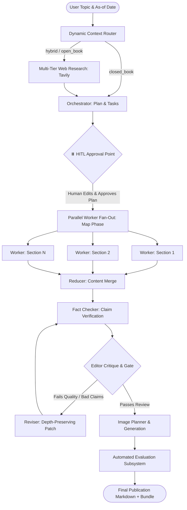

# 🚀 Autonomous Multi-Agent Blog Engine (LangGraph + Human-in-the-Loop)

[](https://blog-writing-agent-wypxaavtobakyamcxfhqzz.streamlit.app/)

[](https://www.python.org/)
[](https://github.com/langchain-ai/langgraph)
[](https://streamlit.io/)
[](https://www.postgresql.org/)
[](#architecture)
[](#evaluation-metrics)

An end-to-end, stateful multi-agent system built with **LangGraph** that autonomously researches, outlines, writes, fact-checks, illustrates, and evaluates publication-grade technical and cultural long-form blog posts.

Features dynamic closed/hybrid/open-book context routing, parallel worker map-reduce fan-out, human-in-the-loop (HITL) plan approval, multi-tier search fallback, self-reflective editorial critique loops, and automated quantitative evaluation.

---

## 🏛️ System Architecture



---

## 🌟 Key Technical Highlights

### 1. Dynamic Context Routing
- Evaluates topic volatility and temporality to route into **`closed_book`** (evergreen theory), **`hybrid`** (evergreen concepts + modern tooling), or **`open_book`** (volatile news, releases, policy).
- Formulates focused, multi-perspective search queries automatically.

### 2. Multi-Tier Resilient Research Synthesis
- **3-tier search fallback**: Official `tavily-python` client $\rightarrow$ direct HTTPS REST API $\rightarrow$ `langchain-community` tools.
- Prevents missing package exceptions or network dropouts from crashing the workflow.
- Ingests and normalizes raw evidence excerpts, assigning stable citation markers (`[E1]`, `[E2]`, ...).

### 3. Human-in-the-Loop (HITL) Outline Approval
- Halts execution after planning via LangGraph's `interrupt_after=["orchestrator"]`.
- Allows human editors to modify task titles, target word counts, and bullets in a live Streamlit data editor before triggering parallel generation.

### 4. Parallel Worker Fan-Out (Map-Reduce)
- Uses LangGraph's `Send()` API to dispatch section generation tasks across parallel worker LLMs.
- Strict section length constraints ($\pm 10\%$) with substantive paragraph expansion.
- **Citation Sanitizer**: Automatically verifies inline evidence markers against active research IDs to prevent ghost/hallucinated citations.

### 5. Self-Reflective Evaluator-Optimizer Loop
- **Strict Fact-Checking**: Extracts core factual propositions and categorizes each as `supported`, `partially_supported`, `unsupported`, or `contradicted`.
- **Editorial Critique**: Evaluates structure, flow, and claim validity.
- **Depth-Preserving Reviser**: Updates content to resolve editor feedback without condensing section word count.

### 6. Automated Quantitative Evaluation Subsystem
Evaluates final content across 6 objective dimensions:
- **Section Coverage**: Planned vs. generated sections ($20\%$).
- **Word Adherence**: Proximity to target word length within bounds ($15\%$).
- **Groundedness**: Ratio of supported claims vs. total verifiable claims ($25\%$).
- **Citation Coverage**: Verified citation presence across claims and sections ($20\%$).
- **Markdown Validity**: Balanced syntax, code blocks, and placeholders ($15\%$).
- **Error Freedom**: Deductions for unrecovered pipeline errors ($5\%$).

### 7. Dual-Mode State Persistence
- **Production Mode**: Persistent thread checkpointing via PostgreSQL (`PostgresSaver`) for resumable sessions and auditing.
- **Zero-Setup Mode**: Automatic fallback to in-memory `MemorySaver` when PostgreSQL is unavailable, allowing instant 1-click execution without Docker.

---

## 📊 Evaluation & Benchmark Results

Demonstrated on the complex, retrospective topic *"Evolution of Indian cinema post indian independence"*:

| Metric | Target | Result | Status |
| :--- | :---: | :---: | :---: |
| **Overall Quality Score** | **> 75.0 / 100** | **91.30 / 100** | 🚀 **Target Exceeded** |
| **Groundedness** | $\ge 80.0\%$ | **100.0%** | ✅ Verified |
| **Citation Coverage** | $\ge 80.0\%$ | **100.0%** | ✅ Verified |
| **Section Coverage** | $100.0\%$ | **100.0%** | ✅ Complete |
| **Invalid Citations** | $0$ | **0** | ✅ Zero Hallucinations |
| **Pipeline Errors** | $0$ | **0** | ✅ Clean Run |

---

## 📂 Project Structure

```text
├── final_backend.py         # Main LangGraph multi-agent pipeline & evaluation engine
├── final_frontend.py        # Streamlit UI with HITL editor, metrics & bundle download
├── Dockerfile               # Container image for the Streamlit application
├── docker-compose.yml       # Streamlit app and local PostgreSQL checkpoint database
├── .dockerignore            # Excludes local secrets and development files from builds
├── requirements.txt         # Pinned production dependencies
├── .env.example             # Environment variable template
├── .gitignore               # Security & secret exclusion rules
└── images/                  # Generated visual diagrams & infographics
```

---

## ⚡ Quickstart

### 1. Clone & Set Up Environment

```bash
git clone https://github.com/your-username/Blog-writing-agent.git
cd Blog-writing-agent

python -m venv myenv
# Windows:
myenv\Scripts\activate
# Linux/macOS:
source myenv/bin/activate

pip install -r requirements.txt
```

### 2. Configure Environment Variables

Copy the example environment file and add your API keys:

```bash
cp .env.example .env
```

Edit `.env`:
```env
OPENAI_API_KEY=sk-...
TAVILY_API_KEY=tvly-...
# Optional:
LANGSMITH_TRACING=false
BLOG_AGENT_MODEL=gpt-4.1-mini
```

### 3. Run locally with Docker Desktop

```bash
docker compose up --build
```

Open `http://localhost:8501`. Docker Compose starts both the app and PostgreSQL; PostgreSQL stores resumable LangGraph checkpoints. Stop the services with `docker compose down` (add `-v` only if you also want to delete the database volume).

To run Streamlit directly instead, start PostgreSQL with `docker compose up -d postgres`, then run:

```bash
streamlit run final_frontend.py
```

The app falls back to in-memory checkpoints when `BLOG_AGENT_DB_URI` is not configured. In-memory checkpoints are not durable across restarts.

## ☁️ Deploy on Streamlit Community Cloud

1. Push this project to a GitHub repository. Keep the repository private if you do not want to publish the source; Streamlit Community Cloud can deploy from a repository you authorize.
2. In Streamlit Community Cloud, create an app from that repository and set the app file to `final_frontend.py`.
3. In the app's **Settings → Secrets**, add your keys as TOML:

   ```toml
   OPENAI_API_KEY = "your-openai-api-key"
   TAVILY_API_KEY = "your-tavily-api-key"
   BLOG_AGENT_MODEL = "gpt-4.1-mini"
   LANGSMITH_TRACING = "false"
   ```

   `OPENAI_API_KEY` is required. `TAVILY_API_KEY` enables web research; LangSmith settings are optional. Do not add `.env` or `secrets.toml` to GitHub.
4. Deploy and use the URL provided by Streamlit Community Cloud to share the app.

Streamlit Community Cloud storage is ephemeral, so PostgreSQL checkpointing is in-memory unless you configure an external PostgreSQL service and set `BLOG_AGENT_DB_URI` in app secrets. Anyone who can use a publicly shared app can trigger model requests charged to your API account; review provider spending limits before sharing the link.

---

## 🛠️ Tech Stack

- **Frameworks**: LangGraph, LangChain, Streamlit
- **LLMs & Multi-modal**: OpenAI (`gpt-4.1-mini`, `gpt-image-2.5-flare` / DALL-E)
- **Web Search**: Tavily Search API
- **State & Storage**: PostgreSQL, Psycopg3, MemorySaver
- **Observability**: LangSmith
- **Validation**: Pydantic v2
